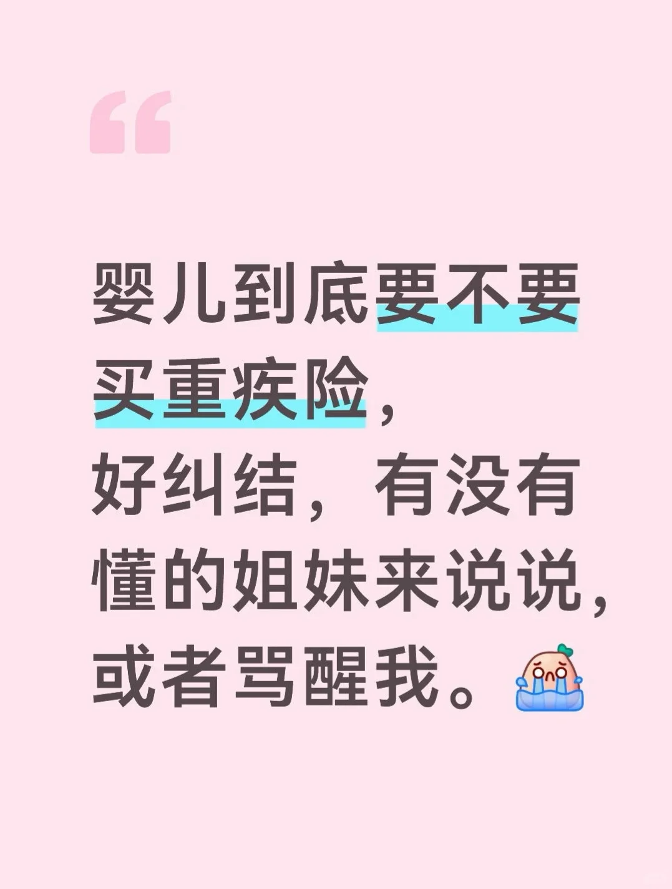
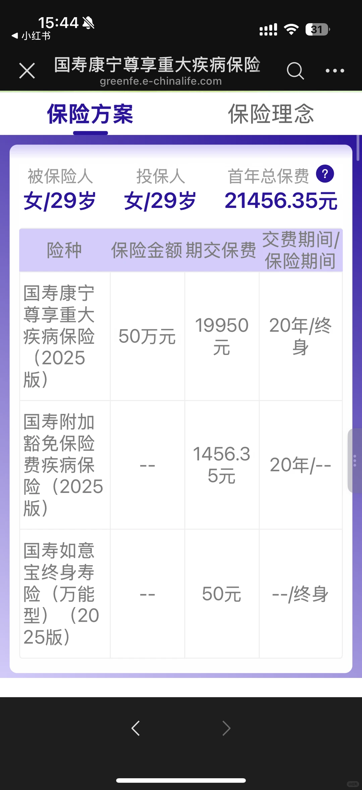
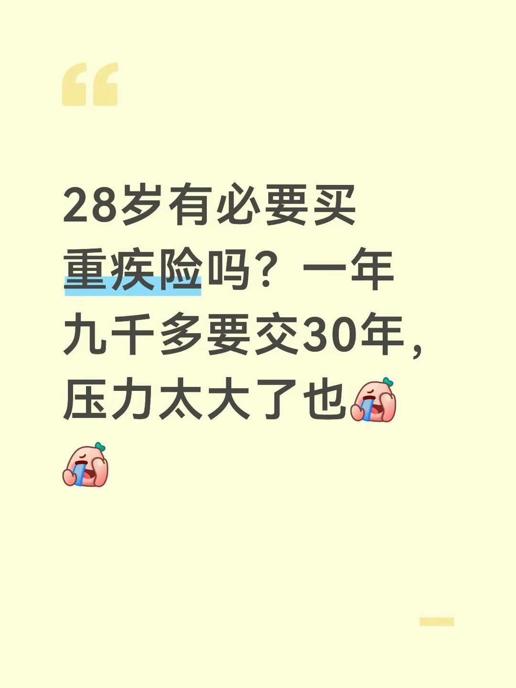
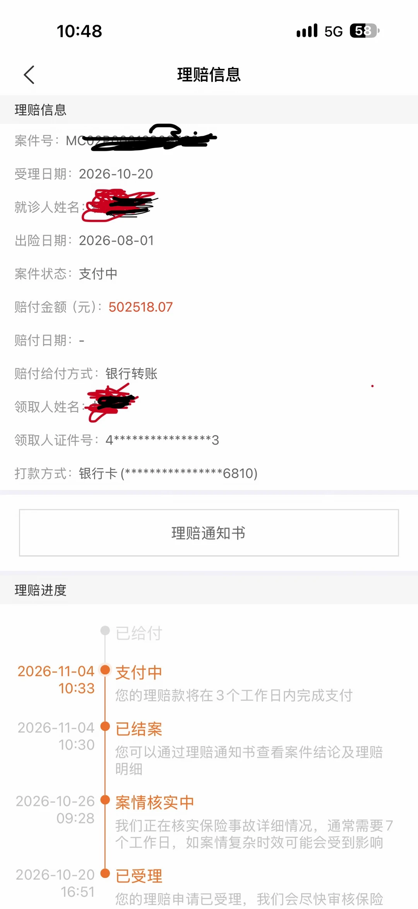
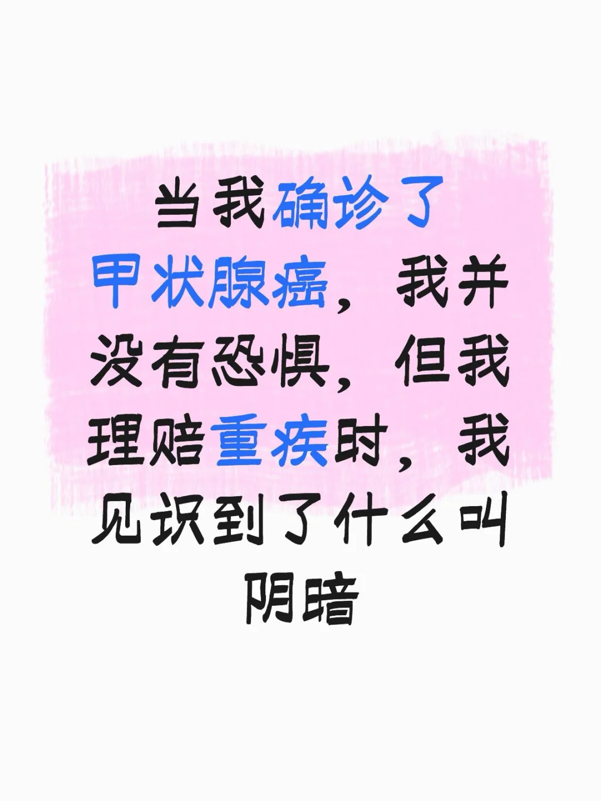
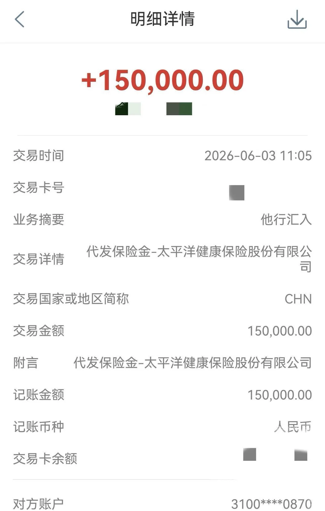
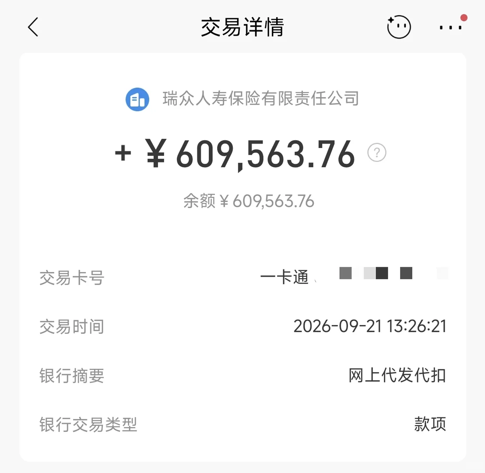
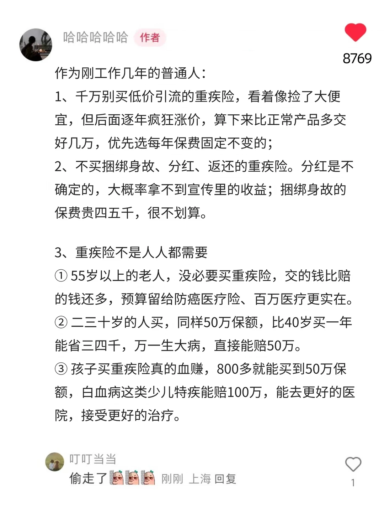

# 从小红书社区看重疾险图文：封面、标题与前几句

本轮研究对象是已经归档的8篇图文，覆盖求助、报价困惑、家庭选择、情绪分享、持续记录、经历复盘和社区背书包装。它们用于深入比较，不代表50篇采集已经完成。总体进度仍为34篇日期、赞评及接口正文核实，其中21篇完成全图与独立性核对。

## 先把社区里的关系看清楚

小红书里的同一篇内容，可以同时被当作一个问题、一份经验或一个可供讨论的判断。操盘时应先确定作者以什么身份加入哪场交流，再安排文字。以下是基于样本的编辑解释，不是平台官方规则，也不是对推荐机制的因果结论。

- **处境能被认出来**：不是泛指“普通家庭”，而是交了两年又想退、已有医保仍犹豫、报价要交30年、手术后正在等理赔。
- **经验有归属**：我买过、我正在经历、我核对过哪些材料，分别需要不同证据。亲历者可以不知道答案；经纪人要说明自己的判断依据。
- **别人有加入的空间**：补充自己的经历、解释一个差别、提出一个新问题。正文不必把一切写成封闭结论，但专业帖应该完成它承诺回答的问题。
- **商业身份需要诚实**：同伴语气可以自然，假装消费者、编造客户、借评论截图冒充口碑会损害信任。“姐妹”本身不是社区感。
- **讨论价值和业务价值分别判断**：求助者帖子评论多，不能说明顾问模仿求助就能获客。要观察专业账号怎样解释、怎样回应、是否持续聚焦同一类问题；本轮无后台咨询数据。

推荐流中的快速识别与搜索后的具体解答，是两种可能的阅读情境。同样的封面和标题要同时检查“刷到能否认出处境”和“搜到能否确认内容相关”；缺乏流量来源数据时不替原帖判断属于哪种渠道。

## 八篇逐项拆解

“封面文字”按已归档原图人工阅读，换行整理；截图金额和正文自述分开。正文摘录保留原句，部分长句用省略号节选。标为“实际起始”的内容不能当成作者优化后的开头。所有保险与医疗说法均属于原作者材料。

### 到底要不要给婴儿重疾险？

[原帖](https://www.xiaohongshu.com/explore/6a17f946000000003700f581) · Doomi~ · 2026-05-28 · 赞224／评504／藏242

**社区中的交流任务：**求助：请有经验的人加入

**封面文字或截图内容：**婴儿到底要不要买重疾险，好纠结，有没有懂的姐妹来说说，或者骂醒我。

**笔记标题：**到底要不要给婴儿重疾险？

**正文前几句：**

> 有医保还要不要给宝宝买重疾险和百万医疗，有没有懂的姐妹来一语惊醒梦中人

**三处怎样配合：**封面中的“婴儿”先限定处境，“好纠结”承认自己没有答案；“姐妹”把回答者放在同伴位置，“骂醒我”邀请别人给直接意见。标题缩成“到底要不要”，让这场讨论的题目清楚。正文再加“有医保”，把泛泛的买不买推进到已有保障是否还缺什么。

**从社区关系看：**不是靠藏住一个现成答案制造悬念，作者公开尚未解决的选择。处于相似阶段的人可能带着自己的比较和经历加入；未读评论，不能确认实际参与者身份或回答内容。

**给重疾险经纪人账号的取舍：**经纪人别伪装成新手妈妈发问。把自己能帮助厘清的那个冲突说出来，再展示资料和判断；引用客户疑问需要真实来源。

### 中国人寿这个重疾险…有点吓到了我

[原帖](https://www.xiaohongshu.com/explore/6a9fbd3c00000000110347cd) · 妖怪炒菜存200w版 · 2026-09-08 · 赞29／评177／藏24

**社区中的交流任务：**报价困惑：把具体材料摆出来

**封面文字或截图内容：**报价截图：女／29岁；首年总保费21456.35元；重疾险50万元、期交保费19950元、20年交／终身；另列附加险。

**笔记标题：**中国人寿这个重疾险…有点吓到了我

**正文前几句：**

> 我才29啊
> 就要这么贵了吗

**三处怎样配合：**封面没有另加大字标题，报价单本身承担信息。“中国人寿这个重疾险”指向眼前材料，“…有点吓到了我”先给感受，尚未声称产品一定不好。“我才29啊”补作者的预期，“就要这么贵了吗”暴露预期与报价的落差。图片里的总保费与重疾险单项保费须分别读。

**从社区关系看：**读者有可核对的对象可以讨论，作者允许别人解释或纠正。两句话已完成提出困惑的任务，不需要强凑百科正文。网页曾看到“这也太贵了”等评论，但该次评论未完整归档，本轮不做评论结构统计。

**给重疾险经纪人账号的取舍：**专业账号可展示经过授权或去除客户信息的真实比较表，明确报价条件、责任及差异。不能复制别人的“我才29”身份，也不能把一个报价推成品牌整体结论。

### 咨询了平安，重疾险好贵啊

[原帖](https://www.xiaohongshu.com/explore/6af32f81000000001c030335) · 崇璟 · 2026-11-10 · 赞309／评552／藏298

**社区中的交流任务：**家庭取舍：这笔支出放进生活里

**封面文字或截图内容：**28岁有必要买重疾险吗？一年九千多要交30年，压力太大了也

**笔记标题：**咨询了平安，重疾险好贵啊

**正文前几句：**

> 和老公都是职工医保……不打算要孩子，所以想着要不要入手重疾险➕百万医疗，但是保费一年也太高了……

**三处怎样配合：**封面同时呈现阶段、年支出与持续时间，把“贵”落到一项长期家庭安排。标题“咨询了平安”补发生过的动作，“好贵啊”保留口头感。正文没有立刻给三点建议，先交代夫妻已有保障、家庭责任和支出压力，让别人知道在什么条件下讨论。

**从社区关系看：**社区求助需要足够的背景让人给有针对性的回应；关系、已有保障和承受能力，比一个孤立价格更能形成可交流的处境。具体年龄不构成推荐结论。

**给重疾险经纪人账号的取舍：**经纪人适合回答：比较保费之前，先把哪些责任和缴费条件放在一起？用真实工作过程回应压力，别仅说“预算有限选某款”。

### 微浸润肺腺癌，重疾险到账。

[原帖](https://www.xiaohongshu.com/explore/6aea9f42000000001500aa00) · 2026方知不惑之意 · 2026-11-04 · 赞96／评212／藏47

**社区中的交流任务：**情绪分享：结果并未结束困惑

**封面文字或截图内容：**理赔信息截图：赔付金额502518.07元；理赔日期2026-10-20；页面另显示2026-11-04结案和支付状态。

**笔记标题：**微浸润肺腺癌，重疾险到账。

**正文前几句：**

> 8月份手术，今天重疾险50万到账。都说微浸润肺腺癌，切除就治愈，但保险给我赔这么多钱，总让我觉得自己病得很重。

**三处怎样配合：**标题用病情与“到账”交代事件，没有“太值了”的评价。截图提供作者展示的理赔记录，不能独立证明全部经历。第一句重复结果但补手术时间；第二句“都说……但……”带出真正要分享的困扰。截图多个日期与“今天”不完全相同，研究不能擅自统一。

**从社区关系看：**“我不是卖保险的”“仅给情绪一个出口”在主动界定交流目的，降低被理解成推销的可能。它提供的是可被理解的感受，不能仅按产品卖点拆解。

**给重疾险经纪人账号的取舍：**专业账号可以尊重这种复杂感受，不拿病人的不安作成交素材。若写自己的服务反思，要有实际经历，不把到账一律改成感谢保险的成功故事。

### 欢迎有同样遭遇的伙伴来聊聊

[原帖](https://www.xiaohongshu.com/explore/6acf535b000000001802b11d) · 涵冰姐-不怕冷 · 2026-10-14 · 赞86／评484／藏95

**社区中的交流任务：**持续记录：找到同样处境的人

**封面文字或截图内容：**当我确诊了甲状腺癌，我并没有恐惧，但我理赔重疾时，我见识到了什么叫阴暗

**笔记标题：**欢迎有同样遭遇的伙伴来聊聊

**正文前几句：**

> 2026.9.9确诊，还在排队手术ing，重疾理赔遭遇理赔部门的层层拖延…这保险到底是个啥
> 【10.16进展：给了理赔通知书】

**三处怎样配合：**封面把“确诊没有恐惧”和“理赔时”的感受作对照，态度很强。标题“欢迎有同样遭遇的伙伴来聊聊”补关系与参与理由，不再重复封面的指责。正文立刻给日期、当前状态和后续更新，让读者可以跟随这件事；现存正文是更新后的版本，不能还原首发时每句话的顺序。

**从社区关系看：**“伙伴”“姐妹”“下周同步大家”把单次发布延长成可以继续追踪的交流。问答和“统一回复”是作者对互动的回应痕迹，但没有评论语料，不能判定实际争议分布。

**给重疾险经纪人账号的取舍：**顾问可以持续记录已授权服务的进展、做过的动作和未解决的问题；不编成功结局，不替当事人下“恶意拖延”等结论。

### 极限拉扯一个月，宝宝重疾险理赔款终于到了

[原帖](https://www.xiaohongshu.com/explore/6a24d8360000000021008aef) · Snowball❄️ · 2026-06-07 · 赞69／评72／藏52

**社区中的交流任务：**经历复盘：先给结果，再给路径

**封面文字或截图内容：**转账明细截图：+150,000.00；交易时间2026-06-03；代发保险金。

**笔记标题：**极限拉扯一个月，宝宝重疾险理赔款终于到了

**正文前几句：**

> 其实保险维权大概就是这么一个通用路径：
> 内部申诉→监管投诉→法院起诉

**三处怎样配合：**截图先提供作者展示的结果。标题“拉扯一个月”交代过程成本，“终于”表达情绪释放，“宝宝”限定处境。正文先给路径再回到个人经历，让有相同困难的人能迅速判断是否值得继续读；后文交代协商和解除合同的代价，结果并非无条件胜利。

**从社区关系看：**经验的可交流性来自“我经历了什么、做了什么、付出了什么”。作者对理赔员动机和法律期限的说法属于待核主张，不能因有转账图就全部采信。

**给重疾险经纪人账号的取舍：**专业内容可学“结果＋过程＋代价”，给出适用条件及自己确实完成的动作。不能把协商经验写成保证能赔的维权公式。

### 甲状腺癌理赔-我的60万理赔金到账了！

[原帖](https://www.xiaohongshu.com/explore/6ab0dd62000000003100dee3) · 阿正 · 2026-09-21 · 赞386／评455／藏294

**社区中的交流任务：**结果与过程：公开一份可参考的经历

**封面文字或截图内容：**交易详情截图：瑞众人寿保险有限责任公司；+¥609,563.76；交易时间2026-09-21。

**笔记标题：**甲状腺癌理赔-我的60万理赔金到账了！

**正文前几句：**

> 实际起始为话题标签及一条新闻推荐；随后“理赔经历：穿刺确诊甲状腺癌后，我就立刻联系保险代理人提交材料报案了……”

**三处怎样配合：**封面金额、标题“我的60万理赔金到账了”一起突出作者展示的结果；完整金额与标题概数区分记录。正文先有新闻引入，之后才进入报案、调查约27天、邮寄住院资料等过程。这个开头不算紧凑，不能因为互动高就把每句都称为优点。

**从社区关系看：**“我的”标出经历归属，过程和旧合同年份让读者有机会比较自己的情况。可参考的具体步骤比空泛“保险很重要”更有讨论内容；产品条件不能跨年份推广。

**给重疾险经纪人账号的取舍：**经纪人要用自己的已授权记录说明过程与限制；没有这些记录，就做资料解释。可改进开头信息顺序，但不要借改稿伪造更顺畅的真实经历。

### xhs上果然有重疾险大佬，一针见血

[原帖](https://www.xiaohongshu.com/explore/6ae31ce4000000001503c558) · 小蔡的保险攻略 · 2026-10-29 · 赞1503／评254／藏2059

**社区中的交流任务：**社区背书包装：需要警惕的反例

**封面文字或截图内容：**评论截图：头像“哈哈哈哈哈”、8769赞；开头“作为刚工作几年的普通人”；下方有“叮叮当当”回复。

**笔记标题：**xhs上果然有重疾险大佬，一针见血

**正文前几句：**

> 果然买重疾险还得看评论区，这思路真的没想到！！！
> 瞬间通透了
> 分享给所有的普通家庭

**三处怎样配合：**封面用“普通人”的口吻和点赞数呈现来自社区的认可。标题“大佬”“一针见血”替读者提前评价；正文又说“没想到／通透了”，连续三处评价，却还没给出新的具体发现。正文接下来才按人群展开建议。

**从社区关系看：**包装让读者以为自己发现了一条社区里被认可的经验。但多篇材料复用头像、赞数及部分图文，来源关系未核；这是社区口吻和背书包装的观察，不能当真实口碑证据。

**给重疾险经纪人账号的取舍：**经纪人应直接说出自己发现的具体差别，展示依据；不制作假评论、不挪用点赞背书。重复包装家族不按多次独立验证统计。

## 操盘上应当怎样改变

### 1. 先决定这篇参加什么交流，再选写法

|原始素材|适合完成的交流任务|专业账号要给的东西|
|---|---|---|
|真实报价、责任对照|帮人厘清一项具体选择|同条件对照、关键差异及作者的判断|
|真实服务记录|让读者看见问题怎样被处理|发生过的动作、变化、仍未解决的地方|
|读者反复问的问题|让同样困惑的人找到可理解的答案|直接回答并解释理由，留下相关的具体追问|
|本人观点与正式资料|提供一个有依据、可讨论的看法|明确立场、支持它的证据和结论边界|

账号需要形成可识别的做事方式。例如持续把“每年保费”放回“家庭责任、既有保障和缴费承受能力”里解释。身份不能只在简介里，读者在几篇正文里应能看见一致的判断方法。当前未指定具体账号资料，以上是内容方向建议，不冒充完成主页与账号数据诊断。

### 2. 封面不必每次都写一条广告标题

报价单、流程记录、对照表、本人手写的具体疑问，都可能承担封面的信息。选择依据是这份材料能否帮助读者认出处境、核对对象或理解差别。截图有存在感，不自动等于真实或专业；装成聊天记录的模板也不自动有社区信任。

### 3. 三处文字允许重复，但要看重复的作用

封面与标题重复核心问题，有助于确认主题；可再分别补条件、发生过的动作或个人态度。不能强制每处都换一句新话。真正要避免的是三处连续“太通透／一针见血／很多人不知道”，读者却始终没获得具体信息。

### 4. 开头先完成本篇的任务

求助可以先交代处境，经验可以先讲结果或卡住的步骤，观点可以先给判断，专业答疑可以直接说明差别。既不要强制反转，也不要一律变成“今天讲三点”。图文里还要分清封面已经开始讲故事，还是翻到第二张才进入正文；页面简介不能代替图片起始段。

### 5. 评论是内容的一部分，研究时要取得证据

目前这8篇没有完整、逐条归档的评论语料，因此只分析作者邀请什么交流、正文留下哪些互动痕迹，不断言大家实际在咨询、争吵或共情。后续应小范围读取代表帖的可见评论，记录问题、经验补充、异议、作者回应以及商业招揽；作者回复不计作独立读者。判断“评论多”之前，先看是谁在说什么。

## 可直接使用的操盘研究提示词

你负责一个重疾险经纪人小红书账号。请把小红书当作有人求助、交换经验、表达态度与核对信息的社区，研究真实图文帖。

先判断：谁在说话、处于什么阶段、把哪件具体的事拿出来交流、期待谁怎样回应。区分作者可见的自我描述与已核实身份。再逐字摘录封面主副文字、笔记标题、图片正文开头、页面正文开头；记录配图的事实作用，不把它们混成同一个钩子。

沿着“刷到或搜到时认出什么处境→点开期待什么→前几句新增什么→后面怎样兑现→别人有什么可以加入讨论”的顺序分析。每项引用原句，解释具体词语、材料和前后衔接。高互动帖也要指出空话、前后承诺不一致和证据不足之处，不替成功帖寻找万能理由。

最后以经纪人身份决定：保留哪种具体问法、怎样展示自己的资料与工作、哪些经历不能借用、哪种态度有事实支持、结尾适合给什么实际答案或提出什么真实追问。有足够素材时给一组封面文字、标题及正文前几句，注明依据；缺素材时明确需要的资料，不编客户和评论。比较不同样本时同时标记正文、事件与配图家族。

评论只有实际读取才分析其内容，没有曝光、点击、来源和咨询数据时，把效果解释标为待验证假设。研究结果用于修改Skill的具体决策规则，不积累一堆必用句式。
